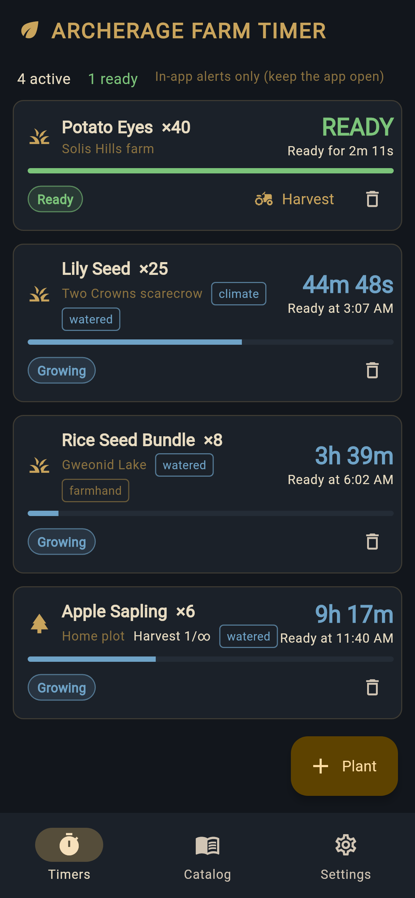
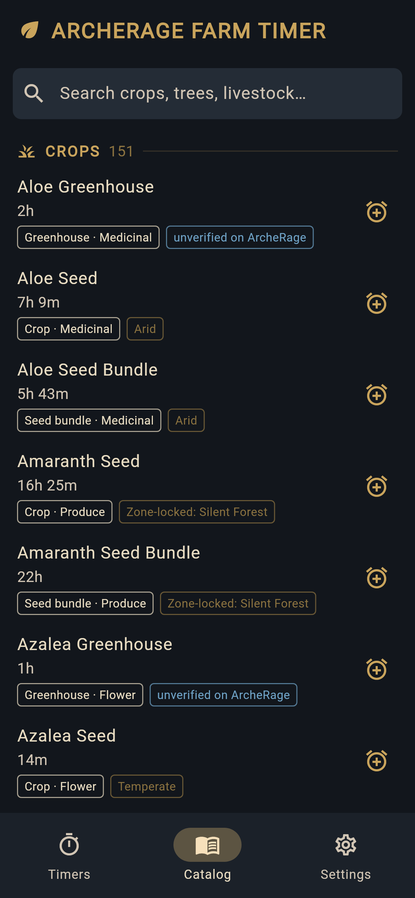
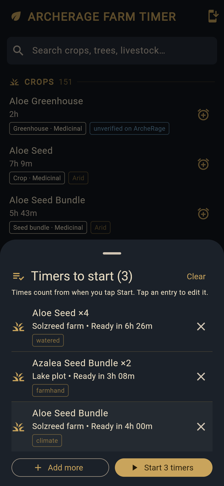
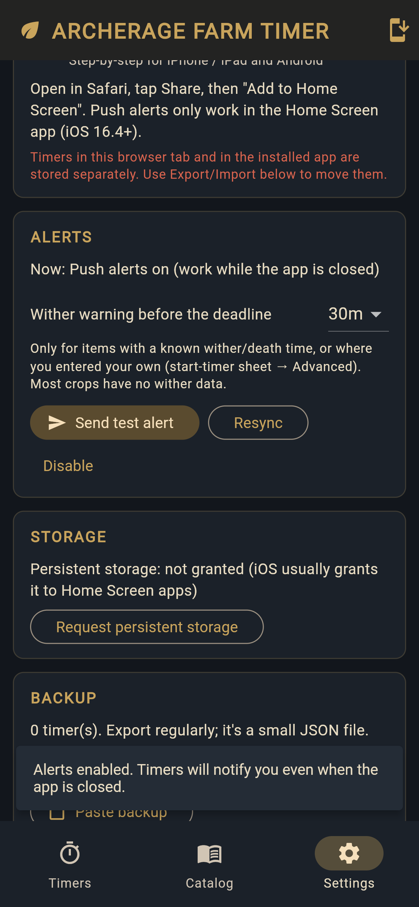

# AR Farm Timer

A crop, tree and livestock timer for **ArcheRage** (an ArcheAge private server).
It's an installable web app (PWA) with optional **push alerts** that arrive even
when the app is closed, plus a **multi-timer queue** so you can plant a whole
farm and start every timer with one tap.

**Live site: <https://artimer.win>**: open it on your phone and use "Add to Home Screen".

| Timers | Catalog | Multi-timer queue | Push alerts |
|---|---|---|---|
|  |  |  |  |

## Features

- **Catalog of 288 farm items** (crops, seed bundles, trees, livestock, aquafarm and more), with search,
  climate tags and an "unverified on ArcheRage" badge where the data isn't confirmed.
  ArcheRage's 2x growth rate is already applied. See [`data/RESEARCH.md`](data/RESEARCH.md) for sources.
- **Timer modifiers**: preferred climate, watered, farmhand, a "planted N minutes ago" offset
  and custom grow times.
- **Live countdowns** with Growing / Ready / Withered states, wither warnings and repeat harvests
  (fruit trees, milking and so on).
- **Multi-timer queue**: add several items to a list, then "Start N timers" at once.
- **Push alerts** through a small Cloudflare Worker, delivered within about a second of the ready time,
  even while the app is closed (iOS 16.4+ Home Screen apps, Android and desktop browsers).
- **Offline-first PWA**: a custom service worker, iOS splash screens, an install guide,
  and JSON export/import for backups.
- Everything stays on your device. The push server stores only the push subscription and the
  scheduled alert times and text. See the [privacy page](https://artimer.win/privacy.html).

## Tech stack

| Part | Tech |
|---|---|
| App | [Flutter](https://flutter.dev) (Dart), mainly built as a **web PWA**. It also runs on Android, iOS, macOS, Linux and Windows using local notifications. |
| PWA shell | Hand-written `web/sw.js` (service worker, generated precache list), `web/pwa.js` (JS bridge for push, storage, install and updates) |
| Push backend | **Cloudflare Worker** (`push-server/`) + **D1** (SQLite) for subscriptions and alerts + a **Durable Object** (`AlertScheduler`) whose alarm fires at the next alert time. An every-minute cron acts as a watchdog. |
| Web Push | VAPID (RFC 8292) and `aes128gcm` encryption (RFC 8291) implemented with WebCrypto, with no runtime dependencies. Apple Declarative Web Push payloads. |
| Hosting | Cloudflare Pages (static `build/web`) |

## Build and run

### Prerequisites
- Flutter SDK (stable) and Python 3 (used by `tool/gen_sw.py`)
- Node.js 22+ for the push server (wrangler needs it; `npx -y -p node@22 ...` works on an older system Node)

### App only (no push server)
```bash
flutter pub get --enforce-lockfile    # exactly the versions in pubspec.lock
flutter test
flutter run -d chrome                  # or: -d linux / macos / windows / an attached device
```
Without a push server the app still works. It shows in-app alerts only while it's open.

### Production web build
```bash
tool/build_web.sh --push-server https://push.example.com
#   optional: --push-server-fallback https://<your-push-server>.workers.dev
#             (same server under a second address; used only if the main one can't be reached)
#   optional: --base-href /<repo-name>/   (when hosting under a sub-path, e.g. GitHub Pages)
cd build/web && python3 -m http.server 8080   # quick local test
```
The push server URL is baked in at build time (`--dart-define=PUSH_SERVER_URL`).
Users can't change it in the app.
Fallback fonts (emoji, CJK, symbols, ...) are self-hosted in `web/fonts/fallback/`
(`fontFallbackBaseUrl` in `web/flutter_bootstrap.js`), so the app never contacts
fonts.gstatic.com. After a Flutter upgrade, run `tool/fetch_fallback_fonts.py` once
(`build_web.sh` stops if a font is missing).

### Deploy the web app (Cloudflare Pages)
```bash
(cd push-server && npm ci && npx --no-install wrangler login)   # once
tool/deploy_web_cloudflare.sh [pages-project-name]
```
`build/web` is plain static files, so you can also host it on any HTTPS static host.

### Run your own push server
All commands run from `push-server/`. See [`push-server/README.md`](push-server/README.md) for the API and free-tier details.

**Local development** (no Cloudflare account needed):
```bash
cd push-server
npm ci                 # exact versions from package-lock.json (wrangler is pinned)
npm run gen-vapid      # creates a VAPID key pair OUTSIDE the repo (../../secrets/vapid.json) and a local .dev.vars
npm run db:local       # create the local D1 tables
npm run dev            # http://127.0.0.1:8787
npm test               # unit tests
npm run test:e2e       # end-to-end test against a mock push service
```
Then build the app with `tool/build_web.sh --push-server http://127.0.0.1:8787`.

**Deploy to Cloudflare** (the free plan is enough):
```bash
cd push-server
npm ci && npx --no-install wrangler login
APP_URL=https://your-app.example/ \
VAPID_SUBJECT=mailto:you@example.com \
ALLOWED_ORIGINS=https://your-app.example \
bash scripts/deploy.sh
```
`scripts/deploy.sh`:
1. generates VAPID keys (if `$SECRETS_DIR/vapid.json` doesn't exist yet; the default is `../../secrets`, outside the repo),
2. creates the D1 database and writes its `database_id` into `wrangler.toml` (the committed value is an all-zero placeholder),
3. applies `schema.sql` and pending `migrations/`, and fills in the **non-secret** vars (`VAPID_PUBLIC_KEY`, `VAPID_SUBJECT`, `ALLOWED_ORIGINS`, `APP_URL`),
4. deploys the Worker and stores the **private** key with `wrangler secret put VAPID_PRIVATE_JWK`.

About VAPID keys:
- The **public** key is meant to be public. It's served at `GET /vapid-public-key` and stored in `wrangler.toml`.
- The **private** key (a JWK) must only ever live in `secrets/vapid.json` (outside the repo), in
  `push-server/.dev.vars` for local dev (gitignored), and as a Wrangler secret. Never commit it.
- Back up `vapid.json`. If the key pair changes, every existing subscription stops working and users
  have to enable alerts again.

### Abuse protection

The push server is a public API, so it has layered limits (details in
[`push-server/README.md`](push-server/README.md)):
- Worker rate limits: 120 API calls/min per IP, 10 `/subscribe` per IP and 10 test pushes per
  subscription per minute, and 30 writes (`/schedule`, `/sync`, `/cancel`, `/test`, `/unsubscribe`)
  per minute per IP **and** per subscription (write limit runs before any D1 lookup; `/test` still
  also has the per-sub strict cap). Over a limit: HTTP 429, with no database work.
- POSTs must come from an allowed web origin, bodies are capped at 512 KB, endpoints must be real push
  services, and unused subscriptions expire on their own.
- Optional edge firewall: on a custom domain (not `*.workers.dev`), one free Cloudflare rate-limiting
  rule can block floods before the Worker runs. The exact rule is in the push server README.
- Not covered: a large distributed attack can still use up the free plan's daily quotas (100k Worker
  requests, 100k D1 rows written). Alerts then pause until the daily reset; the app keeps working.

Dependencies are pinned: `package.json` and `package-lock.json` use exact versions, `push-server/.npmrc`
sets `engine-strict` and `ignore-scripts`, the scripts use `npm ci` and `npx --no-install wrangler`, and
`tool/build_web.sh` runs `flutter pub get --enforce-lockfile`.

## Project structure

```
.
├── lib/                    Flutter app
│   ├── models/             FarmItem, FarmTimer, PendingTimer (queue), Zone
│   ├── services/           timer math, controller, queue, storage, catalog, notifications, push, backup
│   ├── platform/           JS interop bridge to web/pwa.js (web) + stub (native)
│   ├── screens/            timers, catalog, settings (+ settings/ sections), install guide, privacy, "moved" notice
│   ├── widgets/            timer card, start-timer sheet (+ start_timer/ parts), queue sheet, chips, install banner
│   ├── util/               debug-only logger
│   ├── privacy/            in-app privacy text
│   └── theme/
├── web/                    PWA shell: index.html, sw.js, pwa.js, moved.js, privacy.html, manifest, icons, splash, _headers, _redirects
├── assets/                 bundled farm_items.json and zones.json
├── data/                   research notes (RESEARCH.md), the source dataset and the scraper scripts used to build it
├── push-server/            Cloudflare Worker + D1 + Durable Object push backend
│   ├── src/                index.js (API, scheduler DO, cron), webpush.js (VAPID + encryption)
│   ├── scripts/            deploy.sh, gen-vapid.mjs
│   ├── test/               unit + e2e tests
│   ├── schema.sql, migrations/
│   └── wrangler.toml
├── tool/                   build_web.sh, deploy_web_cloudflare.sh, gen_sw.py, fetch_fallback_fonts.py, make_icons.py, sync_data.sh
├── test/                   Flutter unit and widget tests
├── docs/                   DEVELOPMENT.md (detailed feature/dev notes), screenshots
└── android/ ios/ macos/ linux/ windows/   Flutter platform runners
```

More detail on features, data handling and per-platform builds is in [`docs/DEVELOPMENT.md`](docs/DEVELOPMENT.md).

## Feedback welcome

This is a hobby project and I'd really like a **code review**: Flutter structure, the service worker
and PWA handling, the Web Push and VAPID code, the Durable Object scheduler, D1 usage, security,
or anything else that looks off.

- Found a bug or have a suggestion? Open an **[Issue](../../issues)**.
- General questions, ideas or review notes? Start a **[Discussion](../../discussions)**.
- Wrong farm timer data? Please include the item name and a source (wiki, patch notes, or an in-game test).

Pull requests are welcome too.

## License

The code in this repository is released under the [MIT License](LICENSE).
The license covers only this code. The game data in `data/` and `assets/` is compiled from
public sources listed in [`data/RESEARCH.md`](data/RESEARCH.md).

## Disclaimer

AR Farm Timer is a **fan-made** tool. It is **not affiliated with, endorsed by or sponsored by
XLGAMES, Kakao Games or ArcheRage**. ArcheAge, ArcheRage and all related names and marks belong
to their respective owners.

Privacy: <https://artimer.win/privacy.html>
